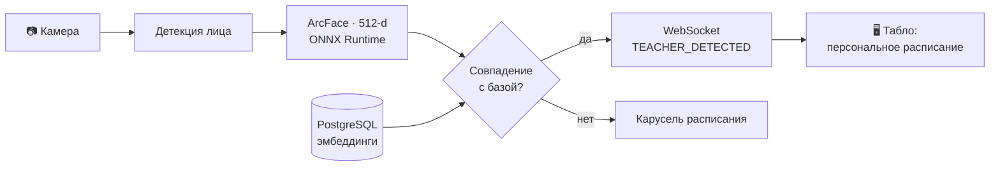
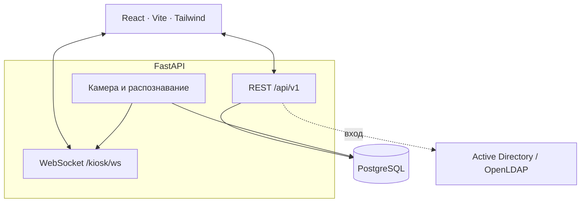

<div align="center">

# 👁️ АРГУС

**Расписание кафедры и умное табло, которое узнаёт преподавателей по лицу**


<sub>Схематичная анимация: камера замечает преподавателя, система его распознаёт, табло показывает персональное расписание</sub>

<br>


[Возможности](#-возможности) · [Как это работает](#-как-это-работает) · [Быстрый старт](#-быстрый-старт) · [Настройки](#-настройки) · [API](#-api)

</div>

---

## ✨ Возможности

| | |
|---|---|
| **📅 Расписание**<br>Сетка занятий, добавление, редактирование и обмен пар, цветовая схема факультетов. | **🔁 Замены и рекомендации**<br>Поиск замен для пары, подбор по опыту ведения курса, «умный» подбор (Weighted Jaccard и CSP), поиск свободных окон. |
| **📊 Нагрузка**<br>Учёт учебной нагрузки преподавателей. | **📥 Excel**<br>Импорт расписания из `.xlsx` / `.xls` с предпросмотром (`dry_run`) и экспорт в `.xlsx` для группы или преподавателя. |
| **👁️ Табло с распознаванием лиц**<br>Видеопоток, ArcFace, персональное расписание при подходе, карусель в режиме ожидания, журнал и статистика. | **🔐 Доступ**<br>Вход через Active Directory / OpenLDAP и управление администраторами. |

## 🧠 Как это работает



1. Камера отдаёт кадры, модель находит лицо и считает 512-мерный вектор (ArcFace, ONNX Runtime).
2. Вектор сравнивается с биометрией преподавателей из PostgreSQL. Порог распознавания настраивается (по умолчанию `0.48`).
3. При совпадении сервер по WebSocket отправляет событие `TEACHER_DETECTED`, и табло показывает расписание этого преподавателя.
4. Когда лицо пропадает, по истечении таймаута (по умолчанию 20 секунд) приходит `TIMEOUT_EXPIRED`, и табло возвращается к карусели расписания кафедры.

Биометрию можно привязать к преподавателю загрузкой фото или снимком прямо с камеры терминала.

### Архитектура



## 🧩 Технологии

| Слой | Стек |
|------|------|
| Backend | Python 3.11, FastAPI, Uvicorn, asyncpg, Pydantic v2 |
| Распознавание лиц | OpenCV, ONNX Runtime, модели InsightFace |
| Frontend | React 19, TypeScript, Vite, Tailwind CSS, axios |
| База данных | PostgreSQL |
| Деплой | Docker (многоэтапная сборка), GitHub Actions |

## 🚀 Быстрый старт

Понадобятся Docker, Git LFS и доступная база PostgreSQL. Веса моделей хранятся в Git LFS, поэтому после клонирования нужен `git lfs pull`.

```bash
git clone https://github.com/Major4ik0/argus-v2.git
cd argus-v2
git lfs pull

docker build -t argus-v2 .
docker run -d -p 8000:8000 --name argus-app --restart always \
  --env-file .env \
  argus-v2
```

Файл `.env` создайте по таблице в разделе [Настройки](#-настройки). Фронтенд собирается в образ автоматически и отдаётся самим бэкендом.

| Что | Адрес |
|-----|-------|
| Приложение | http://localhost:8000 |
| Swagger | http://localhost:8000/docs |
| Проверка работоспособности | http://localhost:8000/api/v1/health |

> 💡 **Камера в Docker (Linux):** добавьте к `docker run` параметр `--device /dev/video0`.
> **Данные:** список администраторов и загруженные файлы лежат в `/app/backend/data` и `/app/backend/uploads`. Подключите к ним тома (`-v`), иначе они пропадут вместе с контейнером.

<details>
<summary><b>📦 Готовые образы из Releases</b></summary>

<br>

При каждом пуше в `main` / `master` GitHub Actions собирает образ и публикует его в разделе Releases как архив `argus_<версия>.tar.gz`. Версия берётся из первой строки сообщения коммита (например, `v3.1`).

```bash
gunzip -c argus_v3.tar.gz | docker load
docker run -d -p 8000:8000 --name argus-app --restart always --env-file .env argus-v2:v3
```

</details>

<details>
<summary><b>🛠 Запуск для разработки</b></summary>

<br>

Нужны Python 3.11+, Node.js 20+ и доступная база PostgreSQL.

**Backend** (запускайте из папки `backend`, чтобы подхватился `.env`):

```bash
cd backend
python -m venv .venv
source .venv/bin/activate        # Windows: .venv\Scripts\activate
pip install -r requirements.txt
uvicorn app.main:app --reload --port 8000
```

**Frontend:**

```bash
cd frontend
npm install
npm run dev
```

Интерфейс откроется на http://127.0.0.1:5173, запросы к `/api` проксируются на бэкенд (`127.0.0.1:8000`). Проверка кода: `npm run lint`.

</details>

## 🔧 Настройки

Настройки читаются из переменных окружения или файла `.env` рядом с запуском бэкенда.

| Переменная | Назначение |
|------------|-----------|
| `DB_HOST`, `DB_PORT`, `DB_USER`, `DB_PASSWORD`, `DB_NAME` | Подключение к PostgreSQL |
| `CORS_ORIGINS` | Разрешённые источники, JSON-список, например `["http://localhost:5173"]` |
| `AD_SERVER`, `AD_DOMAIN` | Сервер Active Directory / OpenLDAP и домен |
| `DEV_MODE`, `DEV_PASSWORD`, `INITIAL_ADMIN` | Резервный вход администратора без контроллера домена. В рабочей среде `DEV_MODE` должен быть `False` |
| `PROJECT_NAME`, `API_V1_STR` | Название API и префикс маршрутов (по умолчанию `/api/v1`) |

```env
DB_HOST=db.example.org
DB_PORT=5432
DB_USER=argus
DB_PASSWORD=change-me
DB_NAME=argus
CORS_ORIGINS=["http://localhost:5173"]
AD_SERVER=ldap.example.org
AD_DOMAIN=example.org
DEV_MODE=False
```

> ⚠️ Не храните реальные пароли и адреса серверов в репозитории: добавьте `.env` в `.gitignore`.

Источник камеры, порог распознавания и таймаут табло задаются в панели администратора киоска и хранятся в БД. Приложение ожидает готовую базу PostgreSQL с таблицами расписания, преподавателей и биометрии киоска.

## 🔌 API

Все маршруты находятся под префиксом `/api/v1`, полное описание есть в Swagger (`/docs`) и ReDoc (`/redoc`).

| Префикс | Раздел |
|---------|--------|
| `/references` | Справочники |
| `/schedule` | Расписание |
| `/workload` | Нагрузка |
| `/recommendations` | Замены и рекомендации |
| `/excel` | Импорт и экспорт Excel |
| `/colors` | Цветовая схема |
| `/admin` | Вход и управление администраторами |
| `/kiosk` | Табло, камера, биометрия, статистика |

**WebSocket табло** — `/api/v1/kiosk/ws`:

| Событие | Когда приходит |
|---------|----------------|
| `CONNECTED` | Соединение установлено, камера и видеоаналитика активны |
| `TEACHER_DETECTED` | Преподаватель распознан (`teacher_id`, `teacher_name`) |
| `TIMEOUT_EXPIRED` | Лицо потеряно, табло возвращается в режим ожидания |

Видеопоток с рамками детекции доступен как MJPEG: `/api/v1/kiosk/video_feed`.

## 📁 Структура проекта

<details>
<summary><b>Показать дерево</b></summary>

```
argus-v2/
├── backend/            # FastAPI-приложение
│   ├── app/
│   │   ├── api/v1/     # маршруты: расписание, нагрузка, замены, Excel, киоск, admin
│   │   ├── core/       # настройки, подключение к БД, календарные утилиты
│   │   ├── repositories/  # доступ к данным
│   │   ├── schemas/    # Pydantic-схемы
│   │   └── services/   # камера и распознавание лиц, Excel, AD-авторизация
│   ├── models/insightface/  # веса моделей (Git LFS)
│   └── requirements.txt
├── frontend/           # React + Vite
├── legacy_qt/          # прежняя версия на Qt (.ui-формы и camera.py)
├── docs/               # материалы для README
├── Dockerfile          # сборка фронтенда и бэкенда в один образ
└── .github/workflows/  # сборка образа и публикация релиза
```

В `legacy_qt` лежат формы и скрипт камеры от прежней версии на Qt. Они копируются в Docker-образ, но в работе нового приложения не участвуют.

</details>
